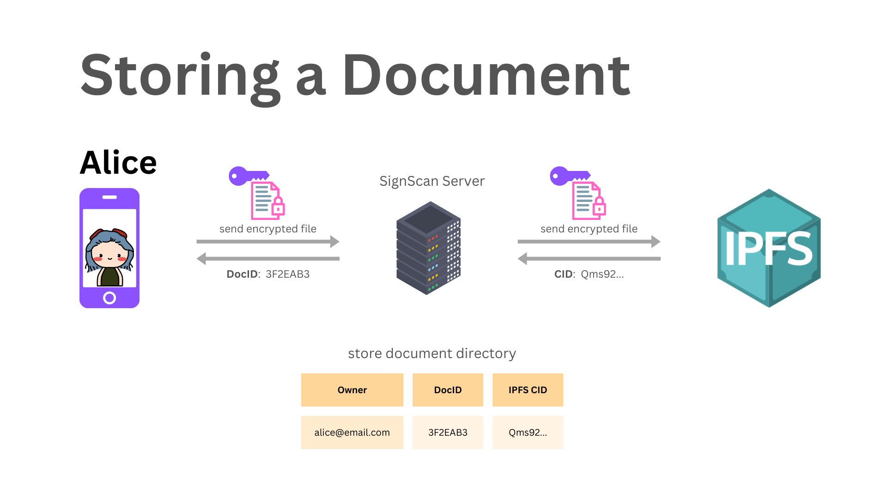
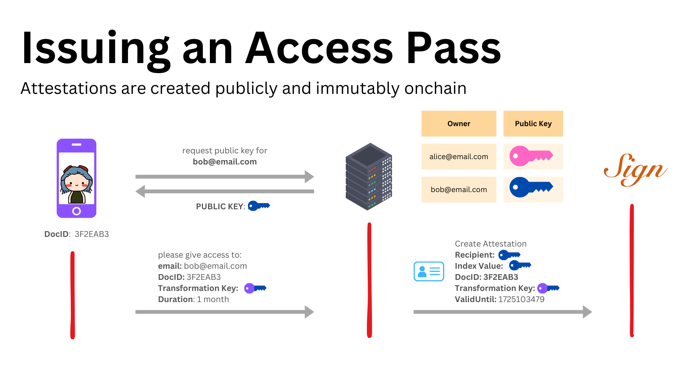
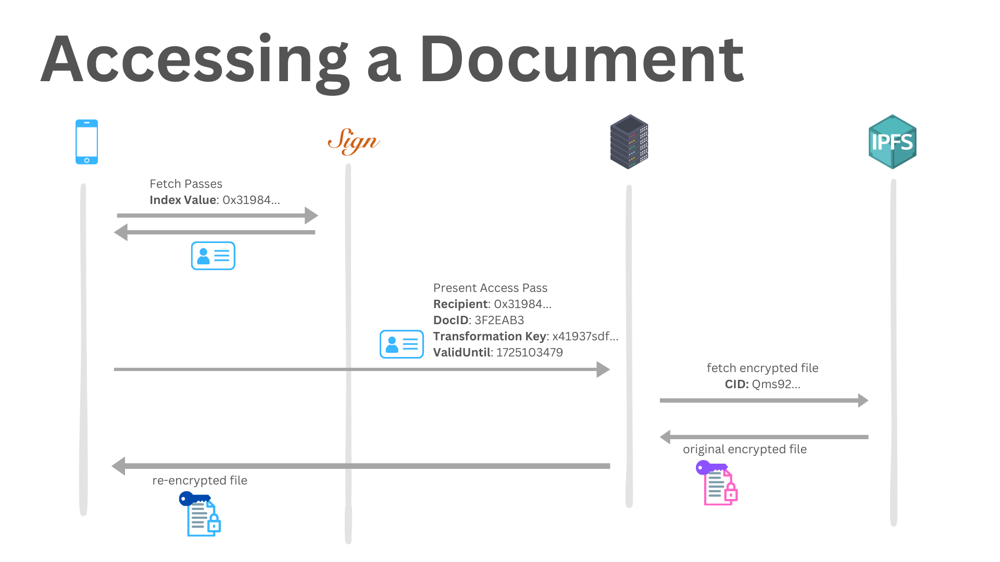
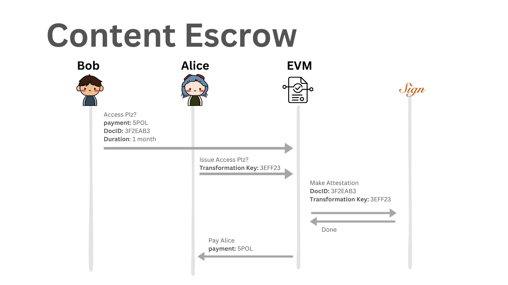
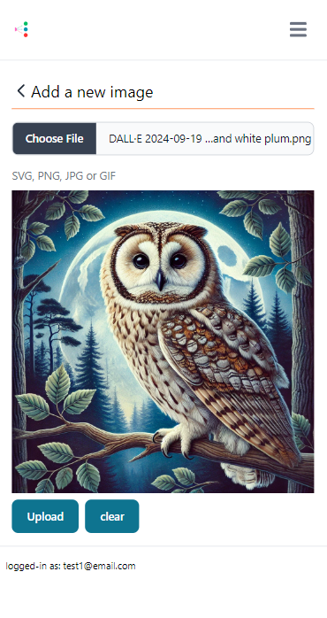
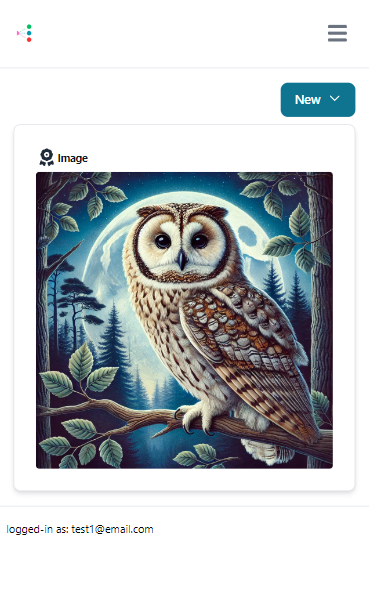
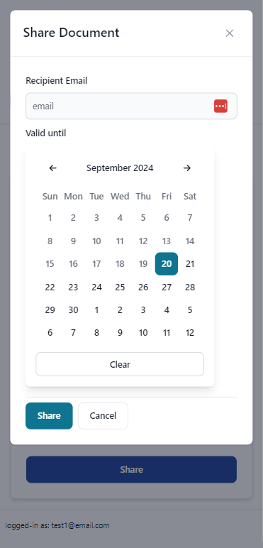
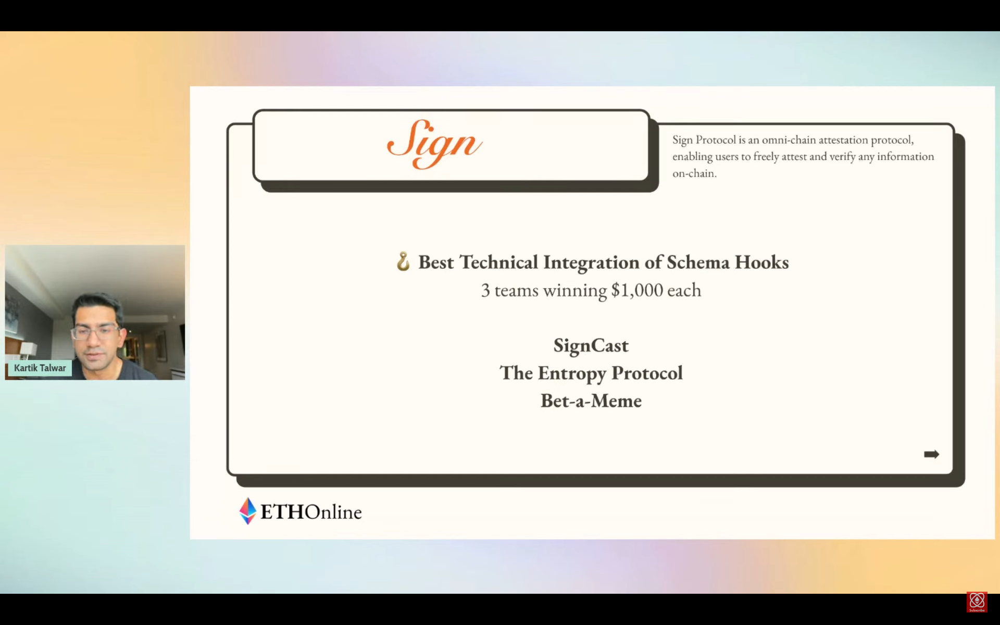
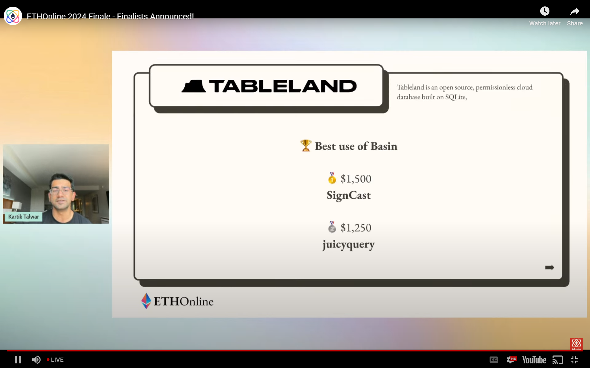

SignCast is a content delivery system that uses Web 3.0 technology to provide trustless and private access to digital content. Primarily aimed at content creators, it provides a platform for their content sharing to be secure and transactional. Content is completely encrypted end-to-end, only decrypted locally on the device. SignCast at a glance seems Web 2.0, however, under the hood it is completely powered by Web 3.0 technologies provided by [Sign Protocol](https://sign.global/) and [Basin by Tableland](https://basin.textile.io/). Sign Protocol allows us to decentralise attestations of document shares. Basin provides us with decentralised storage for our encrypted documents.

## The Problem We Were Trying to Solve

Initially, our goal was to build an app that could allow people to share sensitive documents securely in a way that allowed another person to use that document on your behalf. For example, imagine you were sick and needed a parcel retrieved from the post office. Someone can’t turn up with your driver’s licence and collect your parcel. The problem is that you need sufficient evidence that you have given permission to the person to collect your parcel, the evidence also needs to be completely trustworthy. This is where Web 3.0 comes in, using Sign Protocol we can create an attestation on the blockchain as trustless evidence of your permission for someone else to have access to your document. Our solution also needs to ensure that only the owner and the shared-with individual have access to the document. This is where the technique of [proxy re-encryption](https://www.sciencedirect.com/science/article/abs/pii/S2214212619309901) comes in. We can create a proxy key using the owner’s private key and the shared-with individual’s public key to re-encrypt the encrypted document so that only the shared-with individual can decrypt it using their private key.

This idea evolved into the project it is today as we realised that our trustless and secure pipeline can be applied to the space of content creation. Our system is completely resistant to certain cyber threats such as man-in-the-middle (MITM) attacks.

## Architecture Overview
Our application is made of several interconnected systems: creating and storing a document, sharing a document and issuing an access pass for that document, accessing a document, and, handling sharing of paid content.

To create and store a document, Alice encrypts her document locally on the device with her public key before sending it to our servers where it is then sent to the IPFS, Basin using their s3 bucket adapter.

When sharing documents, Alice will retrieve Bob’s public key from SignCast servers, she will then create the proxy re-encryption key using her private key and Bob’s public key and send the request to our server. Our server will then take the request and create an attestation using Sign Protocol with the validity Alice specified, the re-encryption key, and the document ID.

Upon logging into our application, our server creates a JWT and gives this to the user which acts as an access pass for retrieving documents. Only documents that are shared with the authorised user are retrieved. If the document is owned by the user, it is decrypted using their private key stored locally on the device. If the document has been shared with the user, the proxy key is retrieved from the attestation on Sign Protocol and the encrypted document is re-encrypted with the proxy key. The document is then decrypted locally using the user’s private key.

Our vision for SignCast is to create a marketplace where content creators can share their content and users can purchase it. We have created an escrow system using a Polygon smart contract to facilitate a marketplace. The smart contract works in the following way: Bob will start the escrow process by requesting access to a paid content and sending the payment amount to our smart contract. The smart contract will hold the funds in escrow, Alice will then send the proxy re-encryption key for the content. Then the smart contract creates an attestation using Sign Protocol giving Bob access and then releases the payment to Alice.

## The Tech Stack
**Front-End**

SignCast has two front-end applications. One is a web application and the other is a PWA, both written in [React](https://react.dev/). Our main front-end application is the PWA. The PWA uses a few key packages: [TanStack Router](https://tanstack.com/router/latest), [TanStack Query](https://tanstack.com/query/latest), and [Viem](https://viem.sh/). Viem is used to secure the login and register endpoints by creating and authenticating Ethereum signatures in the EIP-191 format. Our front-end makes use of TanStack Router to create auth routes using [JWTs](https://jwt.io/) and storing these in cookies. TanStack Query is used to simplify async data fetching for our React components.

**Back-End**

SignCast uses [Node Express](https://expressjs.com/) for the back-end. Some key packages we used were [MongoDB](https://www.mongodb.com/) and Viem. Express’ JWT functionality for authentication is passed in all requests to our back-end apart from the login and register POST requests. We write all sensitive end-points to include querying only for documents that the authorised user has access to. MongoDB is used for our internal database to create links between users, shares and documents. Viem is used to get a wallet address from a user’s public key in the sharing process.

## Key Learnings & Takeaways
Apart from learning frameworks that were new to me—Vite and Node Express—I learnt several crucial development practices and tools which make me a better designer and developer. Here are some examples:

* I learnt how to use TanStack Query to simplify asynchronous data fetching.
    
* I learnt how to use TanStack Router to ensure that routes are type-safe.
    
* I learnt how to use [Postman](https://www.postman.com/) to easily test endpoints when creating the back-end application.
    
* I learnt how to use MongoDB to store and query objects from a local database.
    
* I learnt the importance of securing crucial endpoints behind authentication such as JWT.
    
* I learnt how to use cookies within React to create auth routes.
    
* I learnt the important skill of being able to organise project files eg. having separate files for using endpoints in the front-end, having separate files for defining object classes found in MongoDB collections etc.
    

## Conclusion
Initially made for the ETHOnline 2024 hackathon, the project had major success within the event. We were a [finalist](https://twitter.com/ETHGlobal/status/1834627552914375038) and won a few of the partner prizes.

## SignCast Team

Project Lead and Full-Stack Developer: [Dougy Lee](https://www.linkedin.com/in/dougylee/)

Full-Stack Developer: [Alexandr Dunaiskiy](https://www.linkedin.com/in/alexandr-dunaiskiy-9ab5ab101/)

Full-Stack Developer: [Sarmaad Amin](https://www.linkedin.com/in/sarmaad/) - [sarmaad.com](https://sarmaad.com/)

Full-Stack Developer: [Broden Suffern](https://www.linkedin.com/in/bsuffern/)

## Repository
[https://github.com/EthGlobal2024SafeDocs/SafeDocs](https://github.com/EthGlobal2024SafeDocs/SafeDocs)
